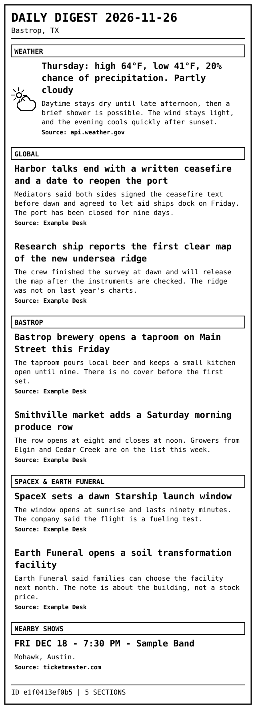
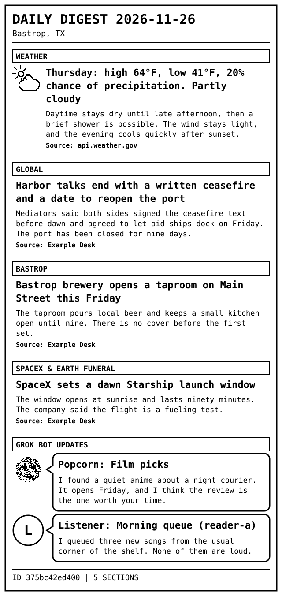

# Daily digest

A morning news receipt for an 80 mm, 203 dpi thermal printer. One edition is built for the local date, rendered to raw TSPL2, and sent through a CUPS queue with `lp -o raw`. Home Assistant calls a loopback trigger at 05:00. Two people read the same strip.

The generator collects candidates from each feed, then asks an OpenAI-compatible chat model to pick the items worth printing and to write a one- or two-sentence summary. If the model cannot be used, a deterministic picker still drops obituaries, ads, investing spam, headlines that repeat themselves, and stories printed in the last week. The print is not cancelled because the model failed.

Personal values stay in the environment. See `.env.example`. Do not commit names, addresses, hostnames, or keys.

## Architecture

| Piece | Role |
| --- | --- |
| `digest_generator.py` | Fetches weather, news, and nearby shows. Writes `output/digest-source-YYYY-MM-DD.json` once. `--export-candidates` writes the model view and does not call a model. |
| `digest_settings.py` | Reads env settings: feeds, section order, titles, model, history, bot updates. |
| `digest_picker.py` | Scores candidates, calls the model, validates JSON, and remembers recent URLs and titles. |
| `receipt_digest.py` | Checks the section list, draws an SVG, rasterizes it, and packs a TSPL2 bitmap. |
| `print_digest_safe.sh` | Holds `print.lock` with `flock`, builds the source file if today's is missing, then renders or submits. |
| `receipt_digest_trigger.py` | Listens on `127.0.0.1` only. `POST /v1/digest/dry-run` or `POST /v1/digest/submit`. |
| `digest-history.json` | URLs and normalized titles from recent editions. Gitignored. |
| `bot-updates/YYYY-MM-DD.json` | Optional notes from household bots. Gitignored. Contract in [docs/bot-updates.md](docs/bot-updates.md). |
| `picks/YYYY-MM-DD.json` | Optional picks and nearby shows from an external bot. Gitignored. Contract in [docs/picks.md](docs/picks.md). |

Pillow wraps text and measures the bitmap. `rsvg-convert` (librsvg) turns the SVG into a PNG. DejaVu Sans Mono is the face on the strip. No other third-party Python packages are required.

## Run flow

1. At 05:00 Home Assistant posts to `http://127.0.0.1:8793/v1/digest/submit` with an empty body.
2. The trigger starts `print_digest_safe.sh --submit`. A second press while the lock is held gets HTTP 409.
3. The shell script takes an exclusive non-blocking `flock` on `print.lock`.
4. If `output/digest-source-YYYY-MM-DD.json` is missing, empty, or cannot be rendered, `digest_generator.py` builds it. The date is the calendar date in `DIGEST_TZ` (default `America/Chicago`), in both the shell and the generator. The generator stops fetching after about 75 seconds and prints whatever it already has, so the whole trigger stays inside 120 seconds. Weather, the news feeds, and the Ticketmaster artist lookups run together on daemon threads, with a hard stop around 35 seconds, so the model still has about 30 seconds plus the time to render. A thread still running at that wall is abandoned, not joined, and logged as timed out. A feed that was never requested is logged as not fetched. Neither is printed as "No new update today". At most two news.google.com calls run at once, and Ticketmaster stays around three. A 429 or a 5xx is retried once, with a short jitter, when the budget still has time. The TLS handshake uses the same deadline as the rest of the fetch.
   - NOAA daytime forecast for the digest date (the overnight period is not used). The default point is the public city center of Bastrop, Texas.
   - Up to 16 candidates from each news feed. Stories older than about 36 hours are dropped when the section has anything newer.
   - Nearby shows, only when a Ticketmaster key and an artist file are set and a concert matches. See [docs/shows.md](docs/shows.md).
   - The bot-updates file, if it is valid and newer than about 30 hours.
   - A picks file for today, if a valid one was written ahead of the run. Otherwise one chat-completions call when `DIGEST_LLM_API_KEY` is set. Any other case uses the fallback picker. The source file records which of those three ran.
   - Recent URLs and titles are skipped, then today's picks are appended to `digest-history.json`.
5. `receipt_digest.py` checks the section order and draws a strip whose height follows the text, up to 6000 dots. Past that, lines are shortened until the strip fits. Characters XML cannot carry are removed, so a damaged source file can still print. A bitmap that touches the edge, or is almost blank or almost solid, is still refused.
6. `--submit` sends the `.tspl` file with `lp -d "$DIGEST_PRINTER_QUEUE" -o raw`. The job id is stored in `state.json`. A `completed` or still-`submitted` job is not sent again. A `failed` job is sent on the next `--submit`.
7. Later presses the same day reuse the source file, so the model is not called again. `--reprint` (or `POST /v1/digest/reprint`) prints another physical copy of that same file. The trigger returns a status code and the renderer's JSON. It does not return stderr. If the trigger's 120 seconds run out, it kills the whole process group so `print.lock` is not left held.

`--dry-run` renders the files and does not call `lp`.

Default section order:

1. WEATHER
2. GLOBAL
3. BASTROP
4. SPACEX & EARTH FUNERAL
5. NEARBY SHOWS, only when a concert matches
6. BOT UPDATES, only when the day's file is valid

NEARBY SHOWS and BOT UPDATES are optional. The other sections are required unless `DIGEST_SECTION_ORDER` removes them. A missing required section, a section out of order, or the old MUSIC section is rejected before anything is sent to the printer. Events, UK, Film/TV, and the daily Music section were removed on purpose. Those notes belong in BOT UPDATES. The Bastrop header can be renamed with `DIGEST_SECTION_TITLE_LOCAL`.

When either optional section is present, each news section prints one item and a shorter summary. When both are absent, each news section prints two items and a longer summary. If both companies have a real story, that section still prints one of each. Shows stay at most three. The strip still stops at 6000 dots (750 mm).

The sample without bot updates includes one nearby show so that section is visible. A real run leaves it off when nothing matches. The sample with bot updates is the shorter layout.

BASTROP is for a childless couple in their early 30s: new openings, food trucks, bars, tastings, live music, markets, and outdoor plans in Bastrop, Smithville, Elgin, Cedar Creek, and east Austin. The model is the judge of what fits. A headline is dropped when its subject is an obituary, a crime, a council or government meeting or vote (including a bare "council votes"), the school board, or a sport (including golf and high school sports). Crime and obituaries are read in the summary too. A council mention that is only in the summary stays. The exemption is a known event phrase: a murder-mystery dinner, a soccer or sports bar, a football watch party, or a football watch. A photo shoot or a photo shooting is a studio phrase, not a crime. A shooting, arrest, killing, stabbing, crash death, or obituary stays out even when a bar or a brewery is named. "Killed" is a crime when a person is killed (a man, a woman, a person, two, or a number), when the line says "killed near", "killed after", or "killed in", or when it says fatal. "Killed by the storm", the rain, the weather, or the council is not a death, and neither is "Senate killed the bill". A death, including "dies at sea", is an obituary. A bar opening after a zoning change stays, because the opening is the subject. Home is Bastrop, Smithville, Elgin, Cedar Creek, McDade, Paige, Red Rock, Del Valle, and east Austin. A home town in the title keeps the item. A home town in the summary keeps it only when the summary places the event there ("in", "at", or "from" the town, including "opens in"), not when the owners also run a spot there, or the line only mentions regulars or a favorite of that town. Bee Cave, Lakeway, Westlake, Dripping Springs, and the other western suburbs, and the northern suburbs Round Rock, Pflugerville, Georgetown, Hutto, Taylor, Leander, and Cedar Park, are left out when that suburb is the title's location, unless the event is placed in a home town. Nearby shows still use the drive radius and do not use this list. With no model, BASTROP does not pick a story. That section prints a fixed line: Local picks unavailable today (AI offline). Town names and opening wording are not consulted. The Google News searches already name the towns. Community Impact and Eater Austin cover a wider area, so those items still have to name a town. Visit Bastrop's calendar did not offer a feed this client could read, and the Bastrop edition of Community Impact does not currently publish its own `/feed` URL, so those are not hardcoded.

SPACEX & EARTH FUNERAL is company news: launches, milestones, and press for SpaceX, and the same for Earth Funeral (the human-composting company). Share prices, stock prices, and a stock or share that jumps, drops, surges, or is upgraded or downgraded are dropped. On a SpaceX item, a downgrade is dropped even without the word "stock". An upgrade or an analyst counts only beside a rating, a price target, or stock or shares, so "SpaceX upgrades the Raptor engine" and "NASA analyst watches the launch" stay. The noun "stock" (a stock of engines, in stock) is not. Earth Funeral's own "funeral service" wording is not treated as an obituary. Earth Funeral is quiet, so a SpaceX story does not get a filler item beside it, and an Earth Funeral item has to actually name Earth Funeral. Each company keeps a story up to about 14 days old only when that company has nothing newer. The sources are Google News RSS searches. Neither company publishes an RSS feed that this client could use.

Sample strips, rendered from fixture data:





## Printer setup

The target is a 4BARCODE-style 80 mm printer that speaks TSPL2 at 203 dpi. 203 dpi is 8 dots/mm, so the printable width is 640 dots.

- Install the printer in CUPS as a raw queue. The host queue can forward to an IPP raw queue on a print server that owns the USB device.
- `DIGEST_PRINTER_QUEUE` (default `receipt`) must already exist. The shell script checks `lpstat -p`.
- The bitmap is TSPL `BITMAP` mode 0. In the packed bytes, bit 0 prints black and bit 1 leaves the paper white. Direction is 1, tear is on, and the label height follows the rendered strip.
- The renderer needs `rsvg-convert`, DejaVu Sans Mono (`fonts-dejavu-core`), and Pillow.

```bash
sudo apt-get install librsvg2-bin fonts-dejavu-core
python3 -m pip install pillow
```

A manual render, with no printer:

```bash
python3 digest_generator.py --out output/digest-source-$(date +%F).json
python3 receipt_digest.py --dry-run --source output/digest-source-$(date +%F).json
```

## Settings

Copy `.env.example` to `.env`. Empty values fall back to the defaults below. The systemd unit loads `.env` with `EnvironmentFile=`.

| Variable | Default | Purpose |
| --- | --- | --- |
| `DIGEST_HOME` | script directory | Where `output/`, `state.json`, and the history file live. |
| `DIGEST_PRINTER_QUEUE` | `receipt` | CUPS raw queue. |
| `DIGEST_TRIGGER_PORT` | `8793` | Loopback port. |
| `DIGEST_TZ` | `America/Chicago` | Edition date and the forecast date. The host zone can differ. |
| `DIGEST_LOCATION_LABEL` | `Bastrop, TX` | Line under the title. |
| `DIGEST_WEATHER_LAT`, `DIGEST_WEATHER_LON` | Bastrop city center | NOAA point. Public coordinates, not a street address. |
| `DIGEST_LOCAL_NEWS_QUERY` | built-in opening queries | One Google News query. When set, it replaces the default local list. |
| `DIGEST_LOCAL_FEED` or `DIGEST_LOCAL_FEEDS` | unset | One URL, or a comma-separated list. When set, the default local sources are not used. |
| `DIGEST_WEATHER_POINT` | NOAA point for the lat/lon | Override the forecast point URL. |
| `DIGEST_GLOBAL_FEED` | BBC world RSS | Global section. |
| `DIGEST_SPACEX_QUERY`, `DIGEST_EARTH_FUNERAL_QUERY` | launch and company queries | Google News queries for the two companies. |
| `DIGEST_SPACEX_FEED`, `DIGEST_EARTH_FUNERAL_FEED` | unset | Full feed URLs. When set, that company's query is not used. |
| `DIGEST_COMPANIES_FEED` or `DIGEST_COMPANIES_FEEDS` | unset | Replaces both company feeds. Items are not forced through the company phrase checks. |
| `DIGEST_TASTE` | sci-fi, space, horror, local openings | Taste note sent to the model. Not copied into the source file. |
| `DIGEST_PROFILE_FILE` | unset | Gitignored interests file. See `docs/interests.example.yml`. Unset means no profile. A missing or unreadable file is recorded and ignored. |
| `DIGEST_FRESH_HOURS` | `36` | Drop older stories when the section has anything newer. |
| `DIGEST_COMPANY_STALE_HOURS` | `336` | How old a company story may be when that company has nothing newer. |
| `DIGEST_ARTISTS_FILE` | unset | Gitignored artist list, one name per line. See `docs/artists.example.txt`. |
| `DIGEST_TICKETMASTER_KEY` | empty | Discovery API key. Empty skips NEARBY SHOWS. |
| `DIGEST_SHOWS_LAT`, `DIGEST_SHOWS_LON` | Bastrop city center | Center of the concert search. |
| `DIGEST_SHOWS_RADIUS_MILES` | `50` | Search radius. |
| `DIGEST_SHOWS_HORIZON_DAYS` | `90` | How far ahead a show may be. |
| `DIGEST_SECTION_ORDER` | weather, global, local, companies, shows, bot_updates | Comma-separated ids. Unknown or repeated ids are ignored and the default order is used. |
| `DIGEST_SECTION_TITLES` | unset | JSON object of id to header, for example `{"local":"BASTROP"}`. |
| `DIGEST_SECTION_TITLE_*` | the headers above | One variable per section (`WEATHER`, `GLOBAL`, `LOCAL`, `COMPANIES`, `SHOWS`, `BOT_UPDATES`). Overrides the JSON object. Max 32 characters. |
| `DIGEST_LLM_BASE_URL` | `https://api.x.ai/v1` | Chat-completions origin, without `/chat/completions`. |
| `DIGEST_LLM_API_KEY` | empty | Bearer token. Empty means fallback picker only. |
| `DIGEST_LLM_MODEL` | `grok-4.7` | Model id. Change this when the provider renames the model. |
| `DIGEST_LLM_TIMEOUT` | `45` | Seconds for one chat call, clamped to 5–90, and also cut to the time left in the 75s generator budget. A HTTP 400 retry uses that same budget. |
| `DIGEST_LLM_REASONING_EFFORT` | `low` | `low`, `medium`, `high`, `xhigh`, or `off`. |
| `DIGEST_CANDIDATES_PER_SECTION` | `16` | Newest feed items considered, clamped to 10–20. |
| `DIGEST_ITEMS_WITH_BOTS` | `1` | News items per section when shows or bot updates are printed. |
| `DIGEST_ITEMS_WITHOUT_BOTS` | `2` | News items per section when neither is printed. |
| `DIGEST_SUMMARY_CHARS_WITH_BOTS` | `200` | Summary budget when an optional section is present. |
| `DIGEST_SUMMARY_CHARS_WITHOUT_BOTS` | `300` | Summary budget when neither is present. |
| `DIGEST_HISTORY_PATH` | `$DIGEST_HOME/digest-history.json` | Recent-item file. |
| `DIGEST_HISTORY_DAYS` | `7` | How many days back a URL or a similar title stays blocked. |
| `DIGEST_BOT_UPDATES_DIR` | `$DIGEST_HOME/bot-updates` | Directory of `YYYY-MM-DD.json` files. |
| `DIGEST_READER_IDS` | `reader-a,reader-b` | Ids allowed in a bot update's `for` field, besides `both`. |
| `DIGEST_BOT_UPDATES_MAX_AGE_HOURS` | `30` | Older bot files are ignored. |
| `DIGEST_BOT_UPDATES_FUTURE_SKEW_MINUTES` | `120` | How far ahead `generated_at` may be. |
| `DIGEST_BOT_UPDATES_MAX` | `4` | Maximum updates in one file (hard cap 6). |

## LLM setup

The generator sends one `POST` to `{DIGEST_LLM_BASE_URL}/chat/completions` using `urllib`. The body is the usual chat-completions shape: `model`, `messages`, `response_format: {"type": "json_object"}`, plus `temperature`, `max_tokens`, and `reasoning_effort` when the server accepts them. A HTTP 400 is retried once without those optional fields, because some compatible servers reject them.

The default model id is `grok-4.7` on `https://api.x.ai/v1`. That id is a setting, not a promise that the name will stay. Set `DIGEST_LLM_MODEL` to pin or to move.

The model sees each section's purpose, the taste note, the interests profile when `DIGEST_PROFILE_FILE` is set, and the candidates (title, url, time, and any summary that is not just the headline). It must return:

```json
{"picks":[{"section":"GLOBAL","items":[{"url":"https://example.com/story","summary":"One or two plain sentences."}]}]}
```

Validation is strict: the only keys are the ones above, every url must be one of the candidates, and each summary must be one or two plain sentences inside the character budget. Obituaries, ads, clickbait, and investing spam are removed before the call as well, and the prompt tells the model to reject them.

These failures all fall back to the deterministic picker, and the source file records a short reason:

- no API key, or a key that contains whitespace
- a base URL that is not `http` or `https`
- timeout or network error
- a non-200 response
- JSON that is not the schema above
- picks that do not match the candidates

About 15 minutes before 05:00, export the candidate list and let an external bot write `picks/YYYY-MM-DD.json`. The generator does not call a model for that export. See [docs/picks.md](docs/picks.md).

```bash
python3 digest_generator.py --export-candidates --date YYYY-MM-DD
```

The fallback is deliberately minimal. It runs when no valid picks file is present and the model is unavailable or the call fails. BASTROP prints one fixed line, `Local picks unavailable today (AI offline).`, and does not choose a story. Every other news section prints the newest items from its feeds that are not repeats and that do not contain a death or violence word in the title or the summary (`killed`, `killing`, `dies`, `dead`, `shooting`, `crash`, and the same family of words). There is no idiom exemption and no taste ranking, so a headline such as "the band killed it" is dropped. Likes, dislikes, and prefer terms still order the candidates sent to the model. They do not reorder the fallback. NEARBY SHOWS does not use the model or this fallback. It uses Ticketmaster when a key is set, and the shows array in the picks file otherwise. A summary that only repeats the headline plus the outlet is replaced with `From {outlet}, {date}.` Google News titles that end in ` - Outlet` use the outlet as the source line instead of `news.google.com`.

The same story from another outlet is treated as a repeat when the headlines are the same event after filler and attribution are removed. "Set to open" matches "opening", and "lifts off" matches "launches". That check also applies when the headlines only overlap. Headlines split when both name a business or a town and those names differ (Round Rock against Bastrop, a brewery against the bakery on the same street, an unnumbered Starship flight against flight 3), and also when the longer headline adds a business the shorter one does not have. When both headlines already share a venue, a generic add-on (shop, music, band, live, patio, or menu) does not split them, so a brewery and that brewery's shop, live music, or band are one story. A coffee shop beside the brewery stays a different story. An extra Texas or Street on one side still matches. The words first and second count as numbers only beside a flight, a launch, or another count word. Exact URLs and exact normalized titles still match. A story printed yesterday is skipped. The model sees the newest history titles, not the oldest, and is told that titles, summaries, and the profile are untrusted data. The same calendar day can be rebuilt. A timestamp with no timezone is read in `DIGEST_TZ`. An unknown zone name falls back to America/Chicago.

The API key is sent only as an `Authorization` header. It is not written into the digest, the history file, or the error strings. Stored URLs have any username or password removed. The taste note and the interests profile are sent to the model and are not copied into the source file. Picker failures are stored as a short code. A broken `state.json` is moved aside as `state.json.corrupt-<time>` and the run starts from an empty state. The rename happens under the print lock and only if the file is still the one that was read. Old `.corrupt-*` copies are deleted after 14 days. A digest entry that is not an object is treated as a broken file. "Died in committee", "killed in committee", and "killed by the storm", the rain, the weather, or the council are not obituaries.

## External picks

See [docs/picks.md](docs/picks.md). The short version: `python3 digest_generator.py --export-candidates` writes `output/YYYY-MM-DD.json` with the sections, rubrics, up to 12 candidates each, the newest 40 history titles, and the taste note and interests profile. Summaries in that file are budgeted at the crowded limit (200). The bot writes `picks/YYYY-MM-DD.json` with the same `picks` objects the model would return, plus `generated_at` and an optional `shows` array. At 05:00 a fresh export is reused and the news feeds are not fetched again. Each reused row is filtered again with the same local, company, freshness, obituary, and spam checks as a live fetch, and the printed title, summary, outlet, and company topic come from the full fields and the configured feeds, not from the file's rubric. Weather still is, and Ticketmaster still is when a key is set. A valid picks file is used instead of the model. A URL matches after tracking parameters are removed. A section whose picks all miss goes to the model when a key is set, and otherwise to the fallback. A stale, symlinked, or invalid file is ignored. With no Ticketmaster key, NEARBY SHOWS prints the `shows` entries that fall in the usual date window and have not already been mentioned. A Ticketmaster key ignores that array.

## Bot updates

See [docs/bot-updates.md](docs/bot-updates.md) for the file name, the JSON schema, the staleness rules, and the receipt layout. The short version: an external process writes `bot-updates/YYYY-MM-DD.json` before 05:00. A bad or stale file is ignored. A good file becomes the BOT UPDATES section, and each news section drops from two items to one so the notes fit under the length cap. Film, television, and music notes belong in that file. Nearby concerts are [docs/shows.md](docs/shows.md), not a bot note.

## Deploy

The trigger is a systemd user unit so it can see the user's CUPS queue.

```bash
mkdir -p ~/.config/systemd/user
cp deploy/receipt-digest-trigger.service ~/.config/systemd/user/
# Edit ExecStart, EnvironmentFile, and ReadWritePaths if the clone is not ~/daily-digest.
systemctl --user daemon-reload
systemctl --user enable --now receipt-digest-trigger.service
loginctl enable-linger "$USER"
```

`loginctl enable-linger` keeps the user service running when nobody is logged in, which is what 05:00 needs. Check it with `systemctl --user status receipt-digest-trigger.service` and `curl -s http://127.0.0.1:8793/health`.

Home Assistant must use host networking so it can reach that loopback port. The automation is in `deploy/homeassistant.example.yaml`: a 05:00 time trigger calls `shell_command.print_digest_safe_submit`.

## Development

```bash
python3 -m unittest discover -v
```

GitHub Actions runs the same command on `ubuntu-latest` after installing `librsvg2-bin`, `fonts-dejavu-core`, and Pillow (`.github/workflows/test.yml`).

The tests cover the fallback picker, the interests profile, the 36 hour freshness rule, fuzzy titles, the company and Bastrop filters, nearby-show matching, mocked chat-completions responses (including bad JSON, a timeout, and a dropped socket), the daytime weather choice (including a split day and the digest timezone), cross-day de-dupe, bot-file parsing (including a bad encoding, a symlink, and an oversized file), layout with and without the bot section, state recovery, and `print_digest_safe.sh` with fake `lp`, `lpstat`, and a local HTTP server. They do not call the public network.

Regenerate the sample PNGs from the fixture payloads:

```bash
python3 -c 'from pathlib import Path; import test_receipt_digest as t; t.write_sample_pngs(Path("docs/samples"))'
```
